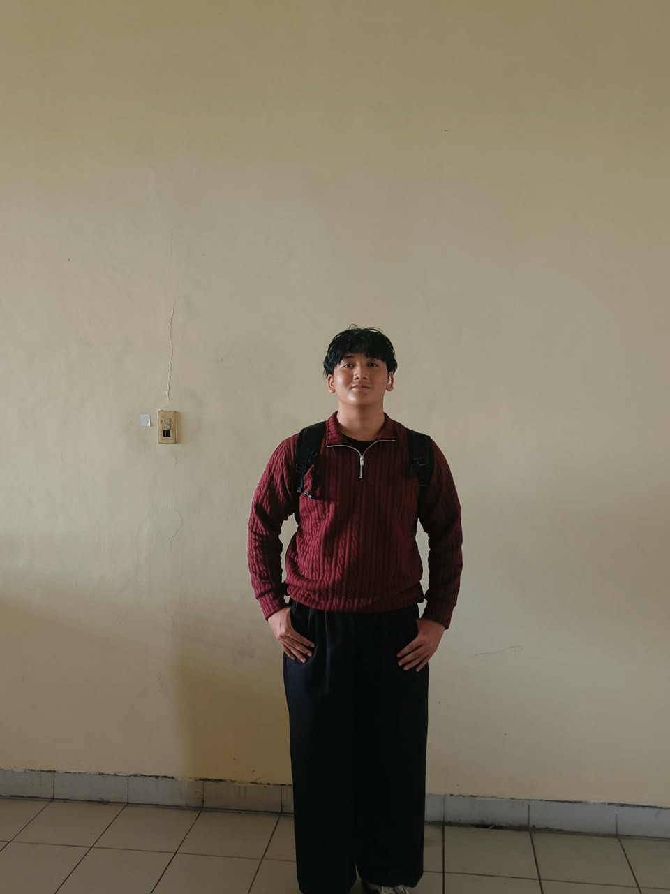

# Mohamad Sindu Oktorino

<div align="center">
  
</div>

<div align="center">

[](http://localhost:3000/)
[](mailto:contact@sinduoktorino70@gmail.com)
[](https://github.com/sinduoktorino)

</div>

> Mahasiswa Informatika & Software Engineer yang suka membangun produk digital yang responsif, berguna, dan berkesan.

## ✨ Tentang Saya

Saya adalah seorang mahasiswa informatika yang tertarik pada dunia web, desain antarmuka, dan teknologi yang membuat pengalaman pengguna terasa lebih nyaman. Saya suka mengubah ide menjadi solusi nyata, mulai dari struktur logika, tampilan visual, hingga pengalaman interaksi yang lebih smooth.

Saya percaya bahwa teknologi terbaik bukan hanya yang canggih, tetapi yang benar-benar membantu orang saat digunakan.

### Fokus saya:
- Front-end development
- Web application engineering
- Backend sederhana dan API dasar
- Produktivitas digital

---

## 🧠 Skills & Stack

### Frontend


### Backend & Tools


### Strengths
- Responsive design
- Clean code mindset
- Problem solving
- UI/UX awareness
- Fast learning

---

## 📌 Project Highlights

Portfolio ini adalah salah satu bentuk karya saya yang menampilkan:
- profil diri
- skill
- tampilan yang modern dan bersih
- form kontak yang terhubung ke backend sederhana
- pengalaman pengguna yang responsif di desktop dan mobile

### Struktur proyek

```bash
portofolio/
├─ web.html
├─ mobile.html
├─ css/
│  └─ style.css
├─ js/
│  ├─ tailwind-cdn.js
│  ├─ tailwind.config.js
│  └─ main.js
├─ server.js
├─ db/
│  └─ portfolio.db
├─ scripts/
│  └─ lihat-pesan.js
├─ img/
├─ README.md
└─ ...
```

---

## 🚀 Cara Menjalankan

```bash
cd portofolio
node server.js
```

Lalu buka:

- `http://localhost:3000/` → versi desktop
- `http://localhost:3000/mobile.html` → versi mobile

---

## 📈 Statistik Singkat

<div align="center">

| Aspek | Nilai |
|---|---:|
| Fokus | Web Development |
| Gaya kerja | Clean, structured, user-first |
| Minat utama | UI/UX + Front-end |
| Karakter | Detail-oriented, fast learner |

</div>

---

## 🤝 Let’s Connect

Saya terbuka untuk kolaborasi, diskusi, maupun peluang kerja yang relevan.

- Email: `contact@sinduoktorino70@gmail.com`
- GitHub: `https://github.com/sinduoktorino`
- Instagram: `https://instagram.com/okto.rino_`

Jika Anda mencari seseorang yang peduli dengan kualitas, tampilan, dan pengalaman pengguna, mari berdiskusi.

---

<div align="center">

Made with ❤️ by <strong>Mohamad Sindu Oktorino</strong>

</div>

